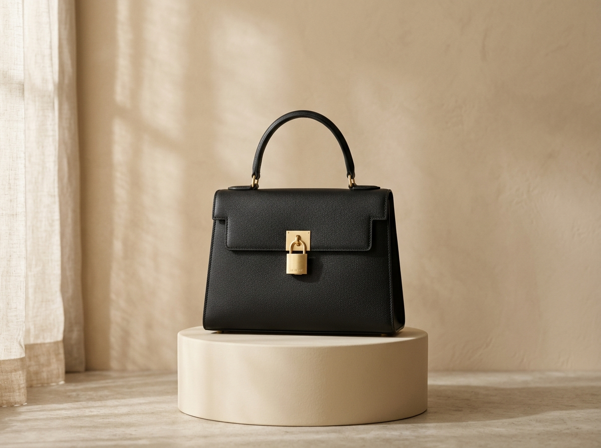

# AURIELLE — Timeless Beauty • Luxury Wear

> **Crafted for Feminine Aura • Delivered Worldwide**  
> An ultra-luxury, quiet luxury editorial e-commerce experience for Maison Aurielle.



---

## ✦ Brand Identity & Heritage

- **Wordmark**: High-contrast Didot/Garamond serif wordmark with the signature 4-pointed metallic gold sparkle star replacing the dot above the lowercase `i`.
- **Hallmark Divider**: Tapered gold hairline dividers anchored by a centered 4-pointed sparkle star (`── ✦ ──`).
- **Subtitles**: `"TIMELESS BEAUTY"` in wide-tracked black serif caps and `"LUXURY WEAR"` in wide-tracked gold caps.
- **Palette**: Warm Cream (`#EADFCB`), Card Cream (`#F4ECDD`), Sand (`#D9C9AE`), Rich Onyx Black (`#0B0B0B`), and Metallic Gold (`#C6A15B` with subtle gradient `#D9B86C` → `#B8913F`).
- **Tactile Grain**: Authentic paper/linen grain texture rendered using an SVG noise filter overlay.

---

## ✦ Key Features

- **Multi-Currency Engine**: Instant live switching between **USD ($)**, **INR (₹)**, **EUR (€)**, and **GBP (£)** across all catalog cards, quick-view modals, and cart drawers.
- **Interactive Shopping Bag**: Slide-over drawer with a dynamic complimentary shipping meter ($500 threshold), quantity controls, item removals, and VIP promo code support (`AURA10`, `GOLDEN`).
- **Curated Wishlist**: One-click heart save with a dedicated slide-over drawer and instant *"Move to Bag"*.
- **Quick-View Modal**: Studio gallery previews, shade swatches (*Noir Black*, *Aura Gold*, *Warm Cream*, *Tuscan Camel*), craftsmanship specifications, and quantity selection.
- **Instant Live Search**: Keystroke search with instant matching across catalog collections and quick inquiry tags.
- **Patron Testimonials**: Rotating international review carousel with 5 gold stars.
- **Global Delivery Visualizer**: Minimal gold vector map highlighting international distribution hubs (Paris, New York, London, Tokyo, Dubai, Mumbai, Sydney).
- **Mobile-First Ergonomics**: Dedicated mobile header and fixed bottom navigation bar (Home, Shop, Search, Wishlist, Bag).

---

## ✦ Repository Structure

```
├── assets/
│   ├── css/
│   │   └── style.css            # Complete styling, animations, and responsive media queries
│   ├── icons/
│   │   ├── logo-compact.svg     # Navbar compact vector lockup with star
│   │   ├── logo-dark.svg        # Full dark vector lockup for footer
│   │   ├── logo-full.svg        # Full light vector lockup
│   │   └── star-motif.svg       # Standalone 4-pointed sparkle star motif
│   ├── images/                  # High-resolution bespoke studio photography
│   └── js/
│       └── main.js              # E-commerce logic, cart, wishlist, currency engine
├── index.html                   # Semantic HTML5 markup with JSON-LD schema
└── README.md
```

---

## ✦ Local Development

To run locally:
```bash
# Using Python
python -m http.server 3000

# Using Node.js
npx serve .
```

Open `http://localhost:3000` in any browser.

---

&copy; 2026 AURIELLE. All rights reserved. Crafted for Feminine Aura.
